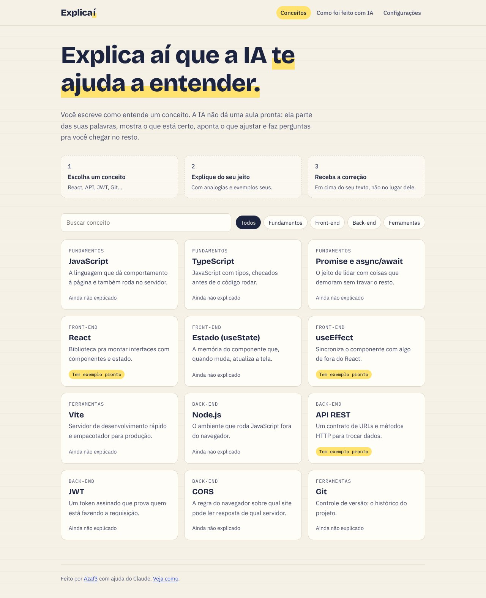
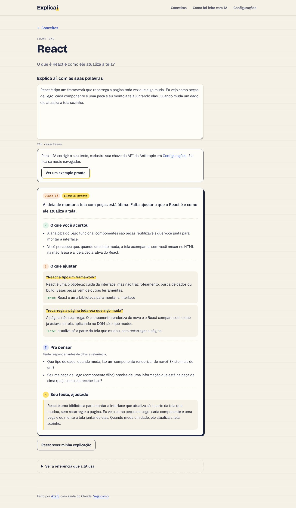

# Explicaí

> Explica aí que a IA te ajuda a entender.

Plataforma de estudo onde **você explica um conceito de programação com as suas palavras** e a IA corrige **em cima do seu texto**: mostra o que está certo, aponta o que ajustar (citando o seu trecho), faz perguntas pra você chegar no que faltou e devolve o seu texto com o mínimo de mudanças.

A ideia é usar IA pra aprender, não pra terceirizar o entendimento.

**[Abrir o Explicaí](https://azaf3.github.io/explicai/)**: dá pra ver exemplos prontos sem chave de API (React, API REST e useEffect).



## Feito com IA, de propósito

Este projeto foi feito em dupla com o Claude (Anthropic), e **os commits mostram isso** com a linha `Co-Authored-By`. A página [Como foi feito com IA](https://azaf3.github.io/explicai/como-foi-feito) e o arquivo [docs/AI_LOG.md](docs/AI_LOG.md) contam quem decidiu o quê, onde a IA errou ou estava desatualizada e como foi pego.

## Como funciona

1. Escolha um conceito (JavaScript, TypeScript, async/await, React, useState, useEffect, Vite, Node.js, API REST, JWT, CORS, Git).
2. Escreva como você entende.
3. O app manda seu texto e a referência do conceito para a API da Anthropic e recebe uma correção estruturada.
4. Cada tentativa fica salva no navegador, pra você ver a evolução.



## Decisões técnicas

| Decisão | Por quê |
| --- | --- |
| **Sem back-end, chave de cada pessoa** | Roda inteiro no GitHub Pages e ninguém gasta o crédito de outra pessoa. A chamada vai direto do navegador para `api.anthropic.com` com o cabeçalho `anthropic-dangerous-direct-browser-access`. A tela de configurações avisa que a chave fica visível no navegador de quem usa. |
| **Structured outputs** (`output_config.format` com JSON Schema) | A tela precisa sempre dos mesmos campos. A API garante o formato, e o código ainda trata `stop_reason: "refusal"`, `"max_tokens"`, JSON inválido e erros HTTP (401, 429, 529). |
| **API version `2026-10-21`** | Versão atual da API, conferida na documentação. Ela não aceita `temperature`, então o app não manda. |
| **Haiku 5.5 como padrão** | Corrigir um parágrafo não precisa do modelo mais caro. Sonnet 5.5 e Opus 5.5 ficam como opção. |
| **Prompt que preserva o texto do dev** | A IA é instruída a partir das palavras e analogias de quem escreveu, não inventar erros e perguntar em vez de entregar a resposta. O texto do usuário vai dentro de uma tag e é tratado como conteúdo, não como instrução. |
| **Referência escondida** | Os pontos que a IA usa ficam num `<details>` fechado, pra pessoa explicar primeiro. |

## Stack

- React 19 + TypeScript + Vite
- React Router (busca e filtro na URL)
- Vitest + Testing Library (25 testes: cliente da API, armazenamento e fluxo da tela)
- oxlint + Prettier
- Deploy estático no GitHub Pages

## Rodando localmente

```bash
npm install
npm run dev      # http://localhost:5173
npm test
npm run build
```

Para usar a correção de verdade, crie uma chave em [platform.claude.com](https://platform.claude.com/) e cole em **Configurações**. Ela fica só no `localStorage` do seu navegador.

## Estrutura

```
src/
  ai/review.ts        prompt, JSON Schema, chamada à API e tratamento de erros
  data/concepts.ts    conceitos, pontos de referência e confusões comuns
  data/demo.ts        exemplos prontos para quem não tem chave
  storage.ts          chave, modelo e tentativas no localStorage
  pages/              Início, Conceito, Configurações, Como foi feito
  components/         Header e exibição da correção
```

---

Feito por [Azaf3](https://github.com/Azaf3) com o Claude.
